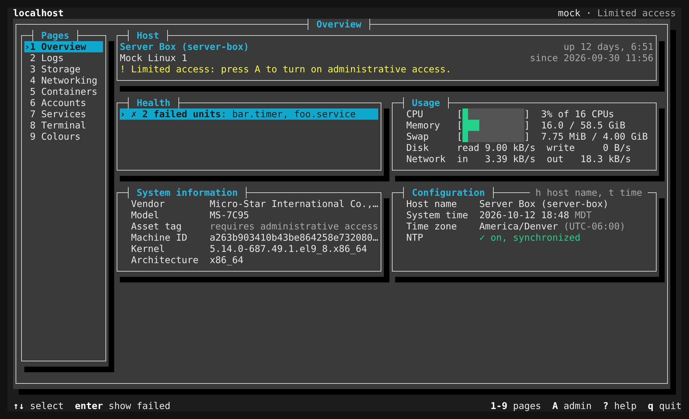
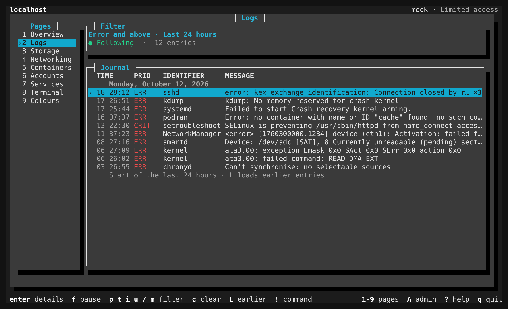
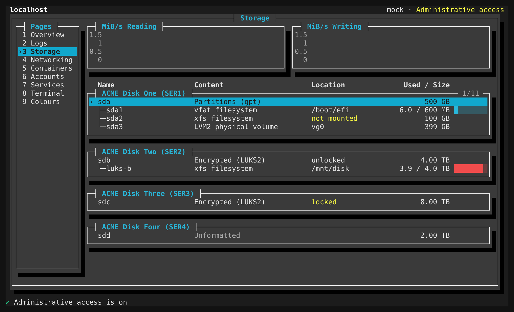
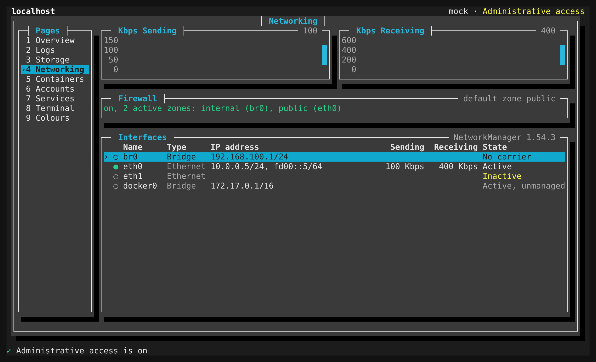
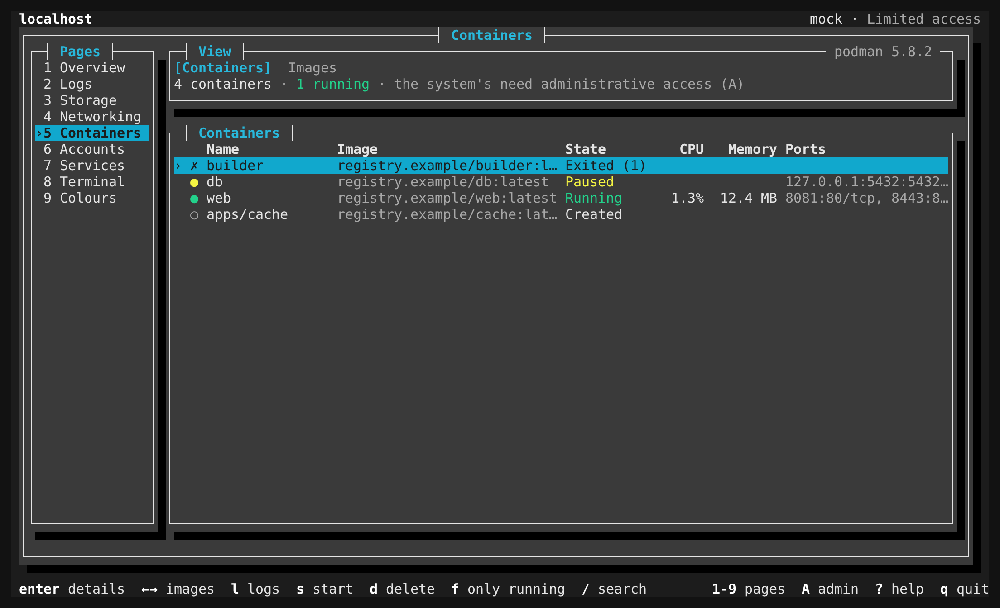
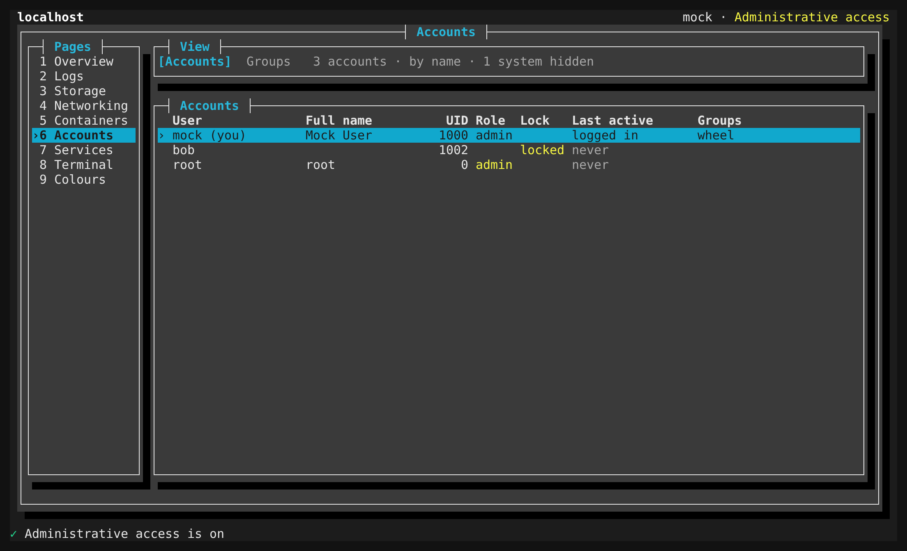
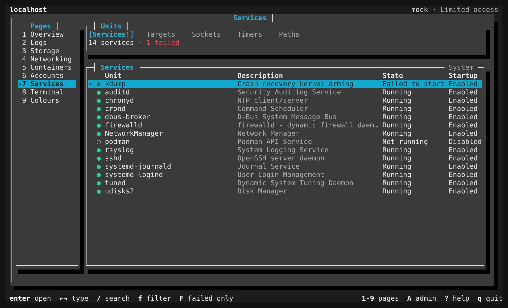
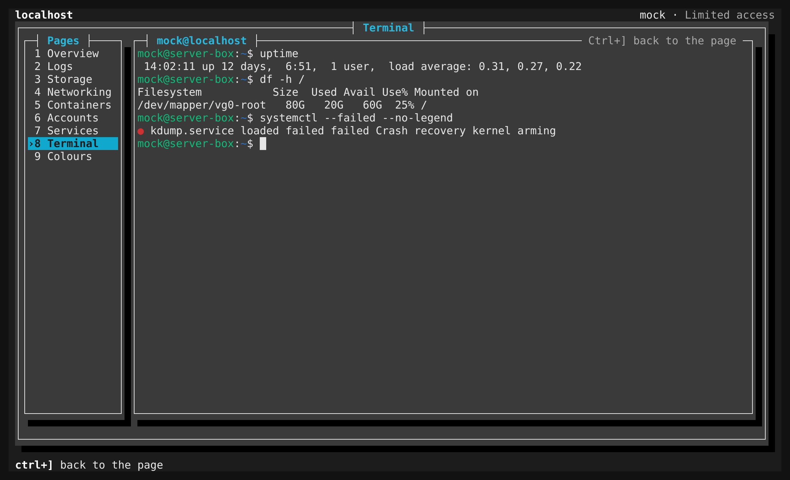
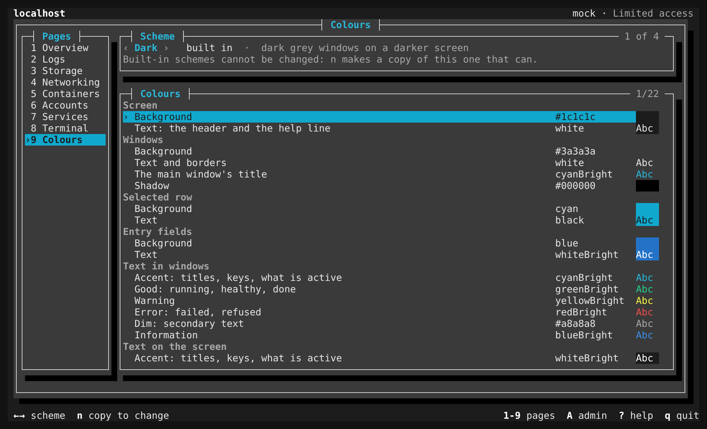

# cockpit-tui

A terminal frontend for [Cockpit](https://cockpit-project.org/).

Cockpit is a web console: a browser UI talking to `cockpit-bridge` on the managed host
over a documented channel protocol. `cockpit-tui` is a **second frontend for the same
backend** — it speaks that protocol directly, so it inherits Cockpit's entire
system-access layer (D-Bus, process spawning, file read/replace, metrics, privilege
escalation) without reimplementing any of it.

It is useful anywhere the browser isn't: a serial console, SSH without port forwarding,
or a host where opening :9090 isn't allowed.



The Overview page on a 120×36 terminal. This and the screenshots under [The pages](#the-pages) were
taken against the mock bridge in `test/mock-bridge/`, using the scenarios the page tests use, so the
host, its disks, interfaces and containers are made up.

## Status

Complete for the pages Cockpit's own `cockpit-system` package provides — **Overview,
Logs, Accounts, Services and Terminal** — plus Cockpit's administrative access switch.

**Storage** (Cockpit's `cockpit-storaged` package) is covered in part: the device tree,
each device's details, and the everyday actions on what already exists — mount and
unmount, unlock and lock, swap on and off, format. Creating or deleting partitions and
partition tables, creating or changing LVM2, MDRAID and Stratis devices, NFS mounts,
iSCSI, VDO, Btrfs subvolumes, key slots and Tang are not.

**Networking** (Cockpit's `cockpit-networkmanager` package) is covered in part: the
interfaces with their traffic, an interface's details, switching one on and off,
"connect automatically", the firewall on and off, and the firewall's rules: the
services and ports each active zone lets in, adding and removing them. Changing
addresses, DNS, routes, MTU or MAC, adding bonds, bridges, teams, VLANs or WireGuard,
adding or reassigning firewall zones, and defining new firewalld services are not.

**Podman containers** (the `cockpit-podman` package) is covered in part: the user's
and, with administrative access, the system's containers and images, their details, a
container's log, and start, stop, restart, pause and resume, delete. Creating and
running containers, pulling, searching and building images, a console inside a
container, commit, checkpoint and restore, renaming, pruning, pods as a whole, health
check runs and quadlets are not.

Software updates, SELinux and the other optional Cockpit packages are not covered.

The line-mode `probe` from the foundation stage remains as `cockpit-tui probe`.

## Using it

```
$ cockpit-tui                                        # this machine (spawns cockpit-bridge)
$ cockpit-tui --host admin@server.example.com        # over ssh
$ cockpit-tui --ws https://server.example.com:9090 --user admin
$ cockpit-tui --page services                        # open on a page
$ cockpit-tui --admin                                # ask for administrative access at once
```

Three transports, one interface. All three yield the same frame stream, so nothing above
the transport layer knows or cares which is in use.

| Mode | How it connects | Requires |
|---|---|---|
| local | spawns `cockpit-bridge` on this machine | `cockpit-bridge` installed here |
| ssh | `ssh <host> cockpit-bridge` | `cockpit-bridge` on the target; no `cockpit-ws` |
| ws | attaches to a running `cockpit-ws` as a peer of the browser | `cockpit-ws` on the target |

The ws mode inherits cockpit-ws's PAM authentication, TLS and remote-host routing, and
needs nothing at all installed on this machine. Its password, any second factor and the
decision to trust a self-signed certificate are asked for in line mode, before the
TUI starts; ssh asks its own questions on the terminal the same way.

Options: `--host [user@]server`, `--ws URL`, `--user NAME` (ws login name, or the ssh
user), `--bridge PATH` (a bridge that isn't on `PATH`, local only), `--insecure` (accept
any TLS certificate, ws only), `--admin`, `--page NAME`, `--theme NAME`, `--help`, `--version`. Unknown
or conflicting options are an error (exit status 2), not silently ignored.

The TUI needs a terminal on both ends; with stdin or stdout redirected it refuses and
points at the probe. Exit status is 0 after a normal quit, 1 if the connection was
lost, and 2 for usage errors.

### Keys everywhere

| Key | |
|---|---|
| `1`–`9`, `Tab`, `Shift+Tab` | switch pages |
| `A` | administrative access (on, or back to limited) |
| `?` | help: every key of the current page, and the shell's; in it, `t` chooses the colour scheme and `l` shows the diagnostic log |
| `q`, `Ctrl+C` | quit (asks first while a shell is running) |
| `Ctrl+]` | on the Terminal page, give the keyboard back from the shell to the page |
| `↑` `↓` `PgUp` `PgDn` `Home` `End` | move through lists |
| `Enter` | open the selected item |
| `Esc` | back, or close a dialog |

The bottom line always lists the keys that do something right now: the page's on the
left, the shell's own on the right. When the page's do not all fit, the help screen has
the rest.

Pasting works where text is typed: the terminal's bracketed paste marks pasted text, so
a pasted newline becomes a space in a text field instead of pressing `Enter`, and text
pasted anywhere else is ignored rather than read as a string of commands.

### The pages

**Overview** — host name, OS and uptime; health (failed units, a scheduled shutdown or
reboot, which `c` cancels); live usage (CPU, memory, swap, disk and network rates, from
the bridge's `metrics1` channel); system information (vendor, model, machine id, kernel);
configuration with dialogs to change the host name (`h`) and the time zone, NTP and
clock (`t`); `R` restart and `S` shut down, with a delay and a message.

**Logs** — the systemd journal, newest first: priority, time range or boot, identifier,
unit and text (`grep`) filters; following with pause and resume; loading earlier entries
page by page; day and reboot separators; repeats collapsed. `Enter` shows every field of
an entry; from there `o` opens its unit on Services. `!` shows the equivalent
`journalctl` command line.



**Storage** — the host's storage as UDisks2 sees it, as a tree: drives with their
partitions, encrypted (LUKS) devices with what is inside once unlocked, LVM2 volume
groups with their logical volumes; for each, what is on it, where it is mounted, its
size and how full it is. Each drive and each volume group has a panel of its own, with
what is inside it; the selection moves through them as one list. Above them are
Cockpit's two plots, **MiB/s Reading** and **MiB/s Writing**: what all the drives
together read and wrote over the last minutes, one column every two seconds, newest
at the right, with the rate numbered down the left of each plot, the time of day along
its foot at every minute, and the current figure in its border (on a small terminal,
one line with both rates). A mounted filesystem's row says how much of it is used --
`5.8 / 14 TB` -- beside a bar. `Enter` shows a device's details (a drive's model, serial and
SMART assessment; a filesystem's UUID, usage and fstab line). With administrative access:
`m` mounts a filesystem (the mount point, read-only and when-at-boot are saved in
`/etc/fstab`, as Cockpit does) and `u` unmounts it; `o` unlocks an encrypted device with
its passphrase and `l` locks it; `s`/`x` start and stop swap; `f` formats, after the
device's name has been typed. Every action asks first. Unlike the web console, nothing is
torn down on your behalf: a device that is mounted, unlocked or part of a volume group
cannot be locked or formatted until that is undone, and the page says what is in the way.
Locking and unlocking do not change `/etc/crypttab`. It needs the `udisks2` package on
the managed host.



**Networking** — the network interfaces NetworkManager looks after (and, marked, the
ones it does not), each with its addresses, what it sends and receives, and its state;
above them Cockpit's two plots, **Sending** and **Receiving**, in bits per second, and
the firewall's state with its active zones. `Enter` shows an interface's details:
carrier and speed, MAC, MTU, addresses, gateway, name servers, and the connection it
uses. With administrative access, `d` switches an interface off and `a` on, `o` turns
"connect automatically" on or off, and `F` switches the firewall (firewalld) on or off;
`l` opens NetworkManager's log. Every action asks first. Switching an interface is
done as Cockpit does it, under a NetworkManager checkpoint: if the switch cuts off the
very connection cockpit-tui runs over, nobody confirms it, and NetworkManager undoes
it by itself after seven seconds -- the page then says so, and offers to make the
change anyway, without that safety net. It needs NetworkManager on the managed host.



`f` opens the **firewall's rules**: each active zone with its interfaces, the services
it lets in with their TCP and UDP ports, and any single ports opened in it. `a` adds
services from firewalld's own list (type to narrow it, `Space` marks, `Enter` adds),
`p` opens custom ports (`8080, 9000-9010`, TCP and UDP), and `d` removes the selected
service or port -- with a warning when it is `ssh` or `cockpit`, the ones that may be
letting you in. Each change is made to the running firewall and to its permanent
configuration, as Cockpit does. Custom ports are added to the zone as ports; Cockpit
wraps them in a new `custom--…` service and reloads firewalld, which this does not.
firewalld shows its rules only to an administrator, so this view needs administrative
access even to read.

**Containers** — podman's containers and images: your own (rootless) ones always, and
the system's (root's) as well while administrative access is on, each marked with its
owner. The list shows state (with a failing health check or a non-zero exit code),
CPU and memory of running containers, and published ports; `←`/`→` switches to the
images, `/` searches, `f` shows only what is running. `Enter` shows a container's
details (image, command, restart policy, networks, volumes; environment variables by
name only, since their values are often secrets) or an image's (tags, size, what uses
it); `l` shows a container's last 500 log lines. `s` starts, `S` stops, `r` restarts,
`p` pauses or resumes and `d` deletes a container -- a running one by force, which the
question says first -- and `d` on an image deletes it, never by force. Every action
asks first. The lists follow podman's own events. It needs podman's API service
(`podman.socket`), which is started if it is not running, as the web console does.



**Accounts** — the accounts and groups on the host, with logged-in state, admin role,
lock state and last login. Create and delete accounts, set passwords, lock and unlock,
force a password change, grant or revoke the admin role, edit group membership, end
sessions, and manage authorized SSH keys. Groups can be created, renamed and removed.



**Services** — systemd units by type (services, targets, sockets, timers, paths), for
the system or your user manager (`o` switches), kept live from systemd's signals:
filter as you type (`/`), failed-only (`F`), state filters (`f`), `c` clears them all.
Details show status, relationships (`g`) and the unit's recent log lines (`l` opens
them on Logs); `s`/`S`/`r`/`R` start, stop, restart and reload, `e`/`d` enable and
disable, `m`/`u` mask and unmask, `x` clears a failed state. Every action asks first and
reports systemd's job result.



**Terminal** — a shell on the managed host, in a window of the page: the header, the
page menu and the help line stay where they are. `Enter` starts it, and puts the
keyboard in it; from then on every key goes to the shell -- digits, `Tab`, `q` and
`Ctrl+C` included -- until `Ctrl+]` gives the keyboard back to the page (as in telnet
and `virsh console`). On the page, `Enter` goes back in, `PgUp`/`PgDn` read back through
its output (2000 lines are kept), `]` sends the shell a literal `Ctrl+]`, `k` ends it,
and once it has ended `r` starts a new one. The shell keeps running, and its output is
kept, while other pages are shown. As in Cockpit's web console the shell runs in the
xterm.js emulator (its headless build), so full-screen programs, colours and cursor
addressing work; `TERM` is `xterm-256color`. Because Ink has parsed every key before
the shell gets it, modifiers on arrows and the function keys do not reach it, and
neither does the mouse.



**Colours** — cockpit-tui's own page, not one of Cockpit's: the colour schemes, and
making your own. `←`/`→` go through the schemes, using each as it is shown. The
built-in ones cannot be changed; `n` makes a copy that can, under a name you give it
(the name `--theme` and the picker then know it by). In a scheme of your own, `Enter`
on any of its 22 colours -- the screen, windows, the selected row, entry fields, and
the text colours on windows and on the screen -- opens a dialog offering the sixteen
basic colours or any `#rrggbb`; each choice is shown on the whole program as you make
it, `Enter` keeps it, `Esc` puts the old one back. What you keep is saved at once in
the settings file, so there is nothing to save and nothing to lose. `r` renames a
scheme of yours and `d` deletes it. The page warns when a text colour is the very
colour it is painted on. A scheme of your own is one set of colours for every
terminal: on one with sixteen colours a shade is shown as the nearest of those.



### Administrative access

Like the web console, cockpit-tui starts with **limited access** and asks for sudo (or
pkexec) only when you turn administrative access on with `A`. sudo's prompts — including
its first-time lecture and "Sorry, try again." — appear in the dialog, the password is
never echoed, and `Esc` cancels at any point. `--admin` opens the dialog at startup.

Actions that need privileges are hidden or refused with a reason while access is
limited, and every page reconnects when the access level changes, exactly as the web
console reloads its pages.

### On a serial console or a plain terminal

- It is laid out as newt draws `nmtui` -- one window with its title in the border and a
  shadow, entry fields, a highlighted selected row -- in a colour scheme you choose:

  | Scheme | |
  |---|---|
  | `dark` (the default) | dark grey windows on a darker screen, a black shadow, the selected row dark on cyan |
  | `light` | near-white windows on a grey screen, the selected row light on blue |
  | `midnight` | deep blue windows, soft colours |
  | `newt` | nmtui's own: a blue screen, a light grey window, the selected row light on blue |

  `?` then `t` opens the picker: each scheme is shown as you move through the list,
  `Enter` keeps it and remembers it for the next start, `Esc` goes back. `--theme NAME`
  picks one for a single run, and `COCKPIT_TUI_THEME=NAME` for whatever it is exported to;
  both win over the remembered one. The **Colours** page makes schemes of your own, which
  all three know by name. The remembered choice and your own schemes are what cockpit-tui
  keeps on the machine it runs on: `~/.config/cockpit-tui/config.json` (or under
  `$XDG_CONFIG_HOME`; `COCKPIT_TUI_CONFIG` names another file, or none when empty).
  Where the terminal has only sixteen colours (a Linux console) every scheme has a
  version made of those; `newt` uses nothing else at any depth. Changing the scheme
  redraws the page from scratch, as changing access does.
- Inside the window the page menu and the parts of each page -- a filter line, a table,
  a group of fields -- are panels: small windows with a title in their border and a
  shadow of their own. A page
  draws them when it is at least 56x16 itself; smaller, it is plain lines.
  `COCKPIT_TUI_PANELS=0` keeps it to plain lines at any size.
- The minimum size is 50x12; below 72 columns the page menu folds away and the header
  names the page, and below 60x16 the window gives up its border and shadow to the page.
- Without a UTF-8 locale every glyph falls back to ASCII (`COCKPIT_TUI_ASCII=1` forces
  it, `=0` forbids it). Nothing depends on colour: states have words, the selection has
  a marker as well as its colours. `NO_COLOR` is honoured: nothing is painted, the
  layout stays, and the selection and the cursor are inverse video.
- Only the lines that change are redrawn, so a once-a-second figure costs a line of
  output rather than a screen — it fits a 9600-baud line.
- Text from the managed host (log messages, unit descriptions, user names, prompts) is
  shown with control characters made visible; an escape sequence in a log line cannot
  move the cursor, recolour the screen or write the clipboard. The same holds for what
  a shell on the Terminal page prints: its escape sequences drive the emulator inside
  the page, and only the resulting characters and colours are drawn.

### When something goes wrong

`?` then `l` shows the diagnostic log: the bridge's stderr, warnings from the Cockpit
library, internal errors. `COCKPIT_TUI_LOG=<file>` also writes it to a file, and
`COCKPIT_TUI_DEBUG=1` adds every control message on the transport. An internal error is
reported on the bottom line and the session carries on; a summary is printed after exit.

## Why this is a port, not a rewrite

Cockpit's client library (`pkg/lib/cockpit.js` and friends) turns out to be reusable
almost intact under Node. Its browser coupling is quarantined in transport bootstrap,
storage and the hash router — it is not woven through the D-Bus/file/spawn APIs.

So `vendor/` holds **unmodified upstream sources** (~5,300 lines, 15 files), and two
small pieces make them run:

1. **`src/shim/dom.ts`** (~150 lines) — the `window`/`document`/`location`/`localStorage`
   surface the library touches at load time. No jsdom.
2. **`src/transport/`** — a transport injected into the library's own
   `transport_globals.default_transport` seam, so the real browser `Transport` (and its
   WebSocket) is never constructed.

Everything above that is the stock Cockpit API: `cockpit.dbus()`, `cockpit.file()`,
`cockpit.spawn()`, `cockpit.http()`, `cockpit.metrics()`.

The Terminal page's emulator is upstream's too: xterm.js, as the npm package
`@xterm/headless` (MIT; the build without a DOM or renderer), not vendored.

**Never edit anything under `vendor/`.** Keeping it byte-identical to upstream is what
makes tracking Cockpit releases a re-copy rather than a merge. If something needs to
change, change it in `src/` or in a type declaration.

## How the code is laid out

| Path | |
|---|---|
| `src/cli.ts`, `args.ts`, `session.ts`, `prompter.ts` | command line, connecting, line-mode prompts |
| `src/config.ts` | the viewer's own settings file (the remembered colour scheme, and schemes made on the Colours page) |
| `src/probe.ts` | `cockpit-tui probe` |
| `src/transport/`, `src/shim/`, `src/superuser.ts` | the foundation: wire, DOM shim, escalation |
| `src/tui/` | the shell: `app.tsx` (layout, global keys), `keyboard.tsx` (layered key dispatch), `privilege.tsx`, `admin.tsx`, `hooks.ts` (D-Bus, processes, files as React hooks), `components/` (table, text input, windows, panels, dialogs, forms), `ink.tsx` and `theme.ts` (the newt look and its colour schemes: import `Text` from `ink.tsx`, not from Ink, so text takes the window's colours; read `colors` and `palette` when drawing, never copy them at module load, since the scheme can change), `text.ts` (measuring and cleaning text) |
| `src/lib/` | what pages share: `journal.ts` (journalctl argv, parsing and streaming; Logs and Services), `metrics.ts` (decoding a raw `metrics1` channel), `objects.ts` (a D-Bus ObjectManager's objects as plain data; Storage and Networking), `plot.ts` (throughput plots in character cells; Storage and Networking), `hosttext.ts` (host text made safe to show) |
| `src/pages/<page>/` | one directory per page |

A page is a component given a width and height. It is mounted only while shown, and
remounted when administrative access changes, so its channels live exactly as long as
its hooks. `src/tui/page.ts` has the contract.

## Development

```
npm run build            # esbuild -> dist/cli.js
npm run dev -- --help    # build, then run with these arguments
npm run watch            # rebuild on change
npm test                 # vitest
npm run typecheck
```

`build.js` sets esbuild's `nodePaths: ['vendor']`. This is load-bearing: the vendored
library imports its own modules with bare specifiers (`cockpit/_internal/location` at
`cockpit.js:16`) that no Node resolver finds on its own. Upstream's `build.js` does the
same with `pkg/lib`. `vitest.config.ts` reproduces it with a `resolve.alias`. It also
stubs Ink's optional React DevTools bridge, which would otherwise fail the bundle, and
bundles React's production build: the development build records a performance measure
for every render, which a screen that updates every second turns into a steady leak.

Two of Ink's internal modules are aliased as `ink-reconciler` and `ink-instances` (in
both `build.js` and `vitest.config.ts`, declared in `src/types/vendor.d.ts`), because
Ink does not export them; see the Ink notes below for why.

### Testing without a Cockpit host

`test/mock-bridge/` is a mock `cockpit-bridge` speaking the real wire protocol on stdio,
driven by a JSON scenario in `COCKPIT_MOCK_SCENARIO`: in-memory files (`fsread1`,
`fsreplace1`, `fsinfo`, `fswatch1`), `metrics1`, scripted HTTP routes (`http-stream2`), scripted D-Bus objects with signals and
side effects, scripted processes and pseudo-terminals, and the `cockpit.Superuser`
conversation. Its message shapes were checked frame by frame against the real Python
bridge; `test/mock-bridge.test.ts` holds it to them. With `COCKPIT_MOCK_LOG` it records
everything the client sends, so tests assert the exact D-Bus calls, argv and file writes
an action makes. The scenario format is documented at the top of `bridge.mjs`.

It also backs the whole program:

```
$ npm run build
$ COCKPIT_MOCK_SCENARIO='{}' node dist/cli.js --bridge "$PWD/test/mock-bridge/bridge.mjs"
```

`test/helpers/` renders Ink into a fake terminal (`ink.tsx`), a page with all its
providers (`page.tsx`), or the app over a mock session (`session.ts`).
`test/e2e.test.ts` runs the built program in a real pseudo-terminal under a private
tmux server — raw mode, the alternate screen, resizing, passwords and exit codes as a user
meets them — and skips itself without tmux.

`test/mock-ws/server.ts` does the same job for the WebSocket path, including the parts
that are easy to get wrong and are not in the user-facing docs: GET-with-header login,
the `X-Conversation` challenge loop, the mandatory `Origin` header, and cockpit-ws
speaking `init` first.

### Testing against a real bridge

`test/real-bridge.test.ts`, `test/lib/journal.real.test.ts` and
`test/pages/*.real.test.ts` talk to an actual `cockpit-bridge`. The mocks can only
confirm that our code agrees with our own reading of the protocol; these are the only
place that catches a misreading. They only ever read — nothing is started, changed or
written on the host — and skip themselves when no bridge is installed:

```
$ apt install cockpit-bridge          # or: dnf install cockpit-bridge
$ npm test
```

They never escalate either: a failed sudo attempt is logged, and can lock an account
where `pam_faillock` is configured. Administrative actions are tested against the mock.

`cockpit-bridge` on its own installs only the `base1` package, which declares no
privileged bridge — so `Bridges` is empty and escalation has nothing to offer. To
exercise the escalation path locally by hand, install the fixture manifest:

```
$ mkdir -p ~/.local/share/cockpit/tui-superuser
$ cp test/fixtures/superuser-manifest.json ~/.local/share/cockpit/tui-superuser/manifest.json
$ node dist/cli.js probe --admin
```

Remove that directory to undo it. On a real machine the platform's own Cockpit packages
supply this, so it is a development convenience only.

### Conformance

`test/chan.test.ts` is a port of upstream's `pkg/base1/test-chan.js` — all 27 of its
channel-protocol tests, run against our transport instead of its mocked browser
WebSocket. If the library behaves the way upstream asserts it behaves, every page built
on top inherits that. `test/mock-peer.ts` is the local stand-in for its `MockPeer`.

One test does not cross over and says so in place: upstream's `check_transport()` asserts
how the browser `Transport` derives a socket URL from `window.location`, and we never
construct that `Transport`.

Upstream's other conformance suite, `pkg/base1/test-dbus-common.js`, is **not yet
ported**. It exercises a real D-Bus service (`com.redhat.Cockpit.DBusTests.Frobber`)
through a real bridge, and what it actually tests — the bridge's D-Bus type marshalling —
cannot be faithfully reproduced by a mock. Running it needs a machine with a bus.

## Protocol notes worth keeping

Things that cost time to discover, recorded so they cost it once:

- Control frames are **pretty-printed multi-line JSON**. The frame parser must be
  length-driven; parsing by line will appear to work and then corrupt.
- Over a pipe the framing is `<length>\n<channel>\n<payload>`; over a WebSocket it is
  `<channel>\n<payload>` with no length prefix, because a WebSocket already has message
  boundaries.
- cockpit-ws computes its allowed origin from the request host, so `Origin` must match
  `Host` and scheme **exactly** or the upgrade is a 403. This is the classic non-browser
  client failure.
- Connect the socket within ~15s of logging in (`cockpit_ws_service_idle`), or the
  session is destroyed.
- A non-zero `exit-status` is **not** a protocol `problem`, and it is negative when the
  process was signal-killed.
- `superuser: "try"` silently runs unprivileged; only `"require"` hard-fails — and **any
  other truthy value** (`true`, `"required"`) behaves like `"require"`.
- The `info` channel stays open after its one payload — resolve on the first message, do
  not wait for a close.
- 64-bit D-Bus integers arrive as JSON numbers and lose precision past 2^53.
- `remove-match` and `unwatch` are unimplemented in the Python bridge; close the channel
  to unsubscribe. Overlapping match rules deliver a signal once per rule.
- Set `SSH_AUTH_SOCK`, or the bridge forks its own `ssh-agent`.
- A bare bridge accepts only `init`, `kill` and `authorize` as channel-less controls;
  anything else (`cockpit.hint()`, `cockpit.jump()`, `cockpit.logout()`) is a protocol
  error that **drops the whole connection**. The transport refuses them (cockpit-ws
  accepts them).
- **Escalation does not move open channels.** A channel opened with `superuser: "try"`
  stays on the unprivileged bridge after `Start`; dropping privileges closes every
  privileged channel with `"terminated"` before `Current` changes; while `Current` is
  `"init"`, new superuser channels queue on the bridge that is still starting. Reopen
  everything on a *settled* change — upstream's reload fires too early, at `init`.
- `cockpit.Superuser.Start("any")` picks the first config and does **not** fall back;
  `Methods` lists only *labelled* configs, so it is usually empty and the method is
  `Bridges[0]`.
- On a pty stream, a `window` outside 1..65535 — or any `window` on a non-pty stream —
  wedges the 356 bridge: it stops reading the client altogether. Validate before sending.
- `metrics1` rates are per **second** (the protocol doc says ms); the first sample of a
  rate is JSON `false`; the Python bridge never compresses rows.
- `journalctl` exits 1 both for "`--grep` matched nothing" and for every real error; only
  stderr tells them apart. The bridge ignores `batch`/`latency` and splits output at
  arbitrary points, mid-line and mid-JSON. Journal values that are not printable UTF-8
  arrive as byte arrays — often carrying escape sequences.
- `cockpit.file().watch()` uses an `fsinfo` watch on bridges since 310, falling back to
  `fswatch1`.
- UDisks2 byte strings (`ay`: device names, mount points, every fstab and crypttab
  field) arrive as **base64 with a trailing NUL**, and go back the same way as
  `{"t": "ay", "v": "<base64>"}`. A configuration item handed to
  `UpdateConfigurationItem` must be the old one exactly as received.
- `PartitionTable.Partitions` is not in disk order (sort by `Partition.Offset`), and
  `Filesystem.Size` is 0 for filesystems UDisks2 cannot size (vfat): use the block's.
- UDisks2's LVM2 objects (`/org/freedesktop/UDisks2/lvm/...`, `Block.LVM2`) exist only
  once `Manager.EnableModule("lvm2", true)` has been called by someone since the daemon
  started; `Manager.LVM2` on the manager object says it has.
- NetworkManager's ObjectManager is at `/org/freedesktop`, one level **above** its own
  objects: `InterfacesAdded`/`Removed` come from there and do not fall under a match on
  `/org/freedesktop/NetworkManager`. Addresses, routes and name servers are plain
  strings only in the `*Data` properties (`aa{sv}`, the inner values still variants);
  the older `Addresses`/`Nameservers` are integers in network byte order. A connection's
  settings are not properties: `GetSettings`, and the `Updated` signal when they change.
  A checkpoint that is not destroyed in time rolls its devices back -- which reconnects
  them even when nothing had changed.
- firewalld tells an unprivileged caller its default and active zones, but not its
  `state` property nor a zone's services and ports (polkit); whether it is on is its
  systemd unit's state.
- The internal `mount.used` / `mount.total` metrics are instanced by **mount point**,
  and list only what is mounted. `disk.dev.read` / `disk.dev.written` are instanced by
  kernel device name and include partitions and device-mapper devices: adding all of
  them up counts the same bytes two or three times, so add up whole drives only.
- `cockpit.http()` on a unix socket is an `http-stream2` channel per request: the open
  carries method, path and headers, the body follows as data and nothing reaches the
  server before the client's `done`. The answer is `ready`, a `response` control message
  (status, reason, headers), data, `done`, and a clean close **even for an HTTP error**:
  the error's body (podman's JSON `{cause, message}`) reaches only the *second* argument
  of the library's failure callback, never a promise's rejection. A response that does
  not end (podman's `events`, `stats?stream=true`) streams through the same channel; a
  socket nobody listens on closes `not-found`. Passing an empty `params` appends a bare
  `?` to the path.
- The vendored Deferred runs callbacks from a timer and does not turn exceptions into
  rejections: a throw in a `.then` callback is an uncaught exception. And a listener that
  returns `proc.close()` (a thenable) makes Node's EventTarget re-raise its rejection.
- The bridge logs to the journal instead of stderr when its fd 2 is a socket, which is
  what Node's `spawn` gives a piped stderr. The transport gives the process it spawns
  a FIFO instead, so a local bridge's messages reach the diagnostic log.

## Ink notes

- Ink's `useInput` delivers a burst of plain bytes as one string: `j` typed five times
  ahead of the screen, or a password followed by `Enter` in one read, arrive as `"jjjjj"`
  and `"secret\r"`. `src/tui/keyboard.tsx` splits control characters out as keys, offers
  a text run whole (a text field takes it in one go) and otherwise one character at a
  time.
- React 19's reconciler has no legacy synchronous mode, so a state update from an input
  handler is scheduled, not applied: the next key in a burst would see the previous
  screen's state. Each key is dispatched inside the reconciler's `discreteUpdates` and
  committed with `flushSyncWork` before the next one is handled — the reason for the
  `ink-reconciler` alias.
- Ink redraws on resize from the tree it already has, before React has seen the new
  size, which leaves a stale frame (a footer drawn twice) when a terminal shrinks.
  `src/tui/size.ts` commits the new size synchronously, and clears the screen first when
  the terminal got narrower; it consults `ink-instances` to leave a suspended screen
  alone (nothing suspends Ink today: the shell on the Terminal page used to).

## License

**GPL-3.0-or-later.** The full text is in [LICENSE](LICENSE).

This is not a preference. `pkg/lib/cockpit.js` is LGPL-2.1-or-later, but its mandatory
import closure includes `cockpit/event.ts`, `cockpit/fsinfo.ts`,
`cockpit/_internal/info.ts` and `cockpit/_internal/location.ts`, all GPL-3.0-or-later.
Copyleft covers the combined work.

Vendored files keep their upstream headers: 6 are GPL-3.0-or-later, 9 are
LGPL-2.1-or-later. Cockpit is Copyright (C) Red Hat, Inc.
